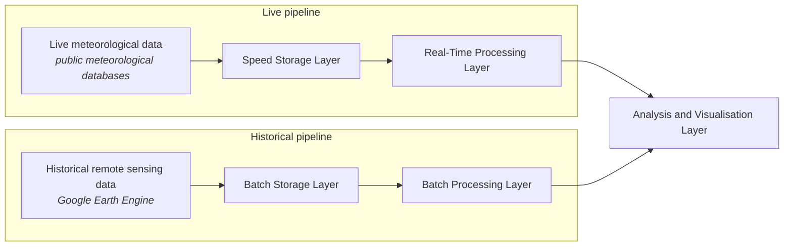
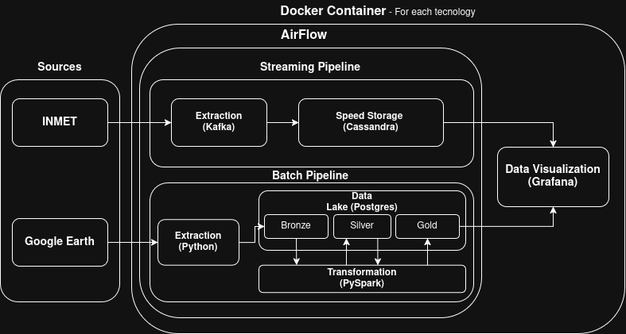

# EcoSensingCalculator (EcoSC)

**Project Proposal & Architecture Review**

---

# Part I — Project Proposal

## 1. Problem Statement

In the digital era, amidst the current ecological crisis caused by the effects of global warming, there is a need for tools capable of quick ecological assessment and prognosis. Such tools can provide instant feedback that influences public opinion and, eventually, legislation, focusing on efficient and targeted remediation of the most impacted (or vulnerable) places and environments.

EcoSensingCalculator aims to fill this gap by giving the public quick, up-to-date information about recurring climatic and meteorological changes in regions of interest.

## 2. Motivation and Impact

We aim to help the public stay better connected to environmental and meteorological changes at a landscape level. This will better equip people to form informed opinions and to push for environmental legislation that reflects current trends and needs.

## 3. Description

The program will perform live analysis using remote sensing data from areas of interest, combined with meteorological data obtained from open sources: Google Earth Engine and public meteorological databases. This data is ingested, stored, processed and visualised through two pipelines:

*Both pipelines converge on one analysis and visualisation layer: live meteorological data and historical remote sensing data pass through separate storage and processing layers, then meet in a shared analysis and visualisation layer.*

## 4. Team and Roles

| Team member | Responsibilities |
|---|---|
| Victor | Data collection; data analysis; documentation |
| Elena | Data rendering; data analysis; documentation |
| Vinicius | Pipeline architecture and software management; documentation |

---

# Part II — Architecture Review

## 5. Refined Architecture

## 6. Selected Technologies and Justification

### 6.1. Overall Infrastructure

- **Docker and Docker Compose** — Provides an isolated and reproducible environment for running the pipeline. Each component can operate as a separate containerized service, simplifying deployment, dependency management, and communication between services while simulating key aspects of a distributed cloud environment.
- **Apache Airflow** — Orchestrates the execution of batch processing workflows by defining, scheduling, and monitoring tasks through Directed Acyclic Graphs (DAGs). Selected for its widespread industry adoption, extensive integration capabilities, and familiarity among team members.
- **Grafana\*** — Provides dashboards for visualizing processed data and monitoring pipeline performance. Its integration with supported data sources allows users to explore trends and track relevant metrics.
  *\* Grafana is not designed to process GeoTIFF (.tif) files directly. Geospatial raster data must first be processed and converted into a suitable format or exposed through a compatible data source. The appropriate integration will depend on the visualization requirements and the selected storage solution.*
- **Data Lake\*** *(Which technology? — open question)* — Provides centralized storage for raw and processed data, including geospatial raster files, meteorological observations, and derived analytical datasets. A suitable storage strategy should support scalable data access, efficient processing, and the preservation of raw data for future analysis.

### 6.2. Batch Processing

- **Python** — Selected for its extensive ecosystem of data engineering and geospatial libraries, ease of integration, and widespread industry adoption. Also familiar to the team, reducing implementation time and development complexity.
- **Apache Spark (PySpark)** — Enables distributed data processing through the Apache Spark framework. Suitable for large-scale transformations and analytical workloads, offering parallel processing capabilities that can help reduce execution time when sufficient computational resources are available.

### 6.3. Real-Time Streaming

- **Apache Kafka** — Serves as the messaging and streaming platform for ingesting and distributing real-time meteorological observations. It decouples data producers from downstream consumers, supports continuous data flows, and enables the integration of stream-processing components. Its widespread adoption and familiarity among team members make it a suitable choice for the proposed architecture.

## 7. Implementation Plan

The implementation will be divided into the following phases:

1. **Infrastructure Setup** — Configure Docker Compose and deploy the required services.
2. **Data Ingestion** — Implement the ingestion of geospatial datasets and meteorological observations from their respective sources.
3. **Batch Processing** — Develop Python and PySpark jobs to clean, transform, and analyze geospatial data.
4. **Streaming Pipeline** — Configure Kafka topics and implement the ingestion and processing of real-time meteorological data.
5. **Data Storage** — Organize raw and processed datasets in the Data Lake, defining appropriate formats.
6. **Visualization and Monitoring** — Integrate Grafana with compatible data sources to display analytical results and monitor pipeline performance.

## 8. Project Risks and Mitigation Strategies

### 8.1. Data Volume and Computational Complexity

- **Risk:** Processing geospatial data across the entire Brazilian territory may involve billions of pixels or observations, resulting in substantial computational and storage requirements. Processing the full dataset at its highest spatial and temporal resolution may also introduce redundant calculations and unnecessary resource consumption.
- **Mitigation:** Select representative datasets that capture sufficient spatial, temporal, and environmental variability while remaining manageable within the available computational resources. Apply spatial and temporal filtering, avoid redundant processing, and use partitioning and parallel processing where appropriate. The initial implementation should prioritize a manageable geographic area and scale up incrementally.

### 8.2. Resource Constraints

- **Risk:** Running multiple containerized services alongside Spark processing workloads on local machines may lead to memory shortages, CPU contention, and increased execution times.
- **Mitigation:** Establish resource limits for Docker containers, optimize Spark configurations, and benchmark workloads using progressively larger datasets. Prioritize essential services and adjust the pipeline according to the hardware available.

### 8.3. Data Ingestion and Availability

- **Risk:** External data sources may experience downtime, inconsistent update intervals, missing observations, or changes in data formats, affecting pipeline reliability.
- **Mitigation:** Implement retry mechanisms, error logging, data validation, and checkpointing where appropriate. Design ingestion processes to tolerate temporary failures and support recovery without unnecessary data duplication.

### 8.4. Integration and Data Compatibility

- **Risk:** Integrating geospatial raster data, streaming observations, processing engines, storage systems, and visualization tools may require additional transformations or specialized connectors.
- **Mitigation:** Define standard interfaces and data formats for each pipeline stage. Validate compatibility through small-scale integration tests before deploying the complete architecture, and document the dependencies between components.

### 8.5. Data Quality and Processing Latency

- **Risk:** Missing values, inconsistent timestamps, invalid geospatial coordinates, and processing bottlenecks may reduce the accuracy and timeliness of analytical results.
- **Mitigation:** Introduce data-quality checks, consistent timestamp handling, schema validation, and monitoring of processing latency. Establish acceptable thresholds for data completeness and end-to-end processing time.

---

*Note: While the contents of the proposal are original, its formatting and figures were constructed using Claude.*